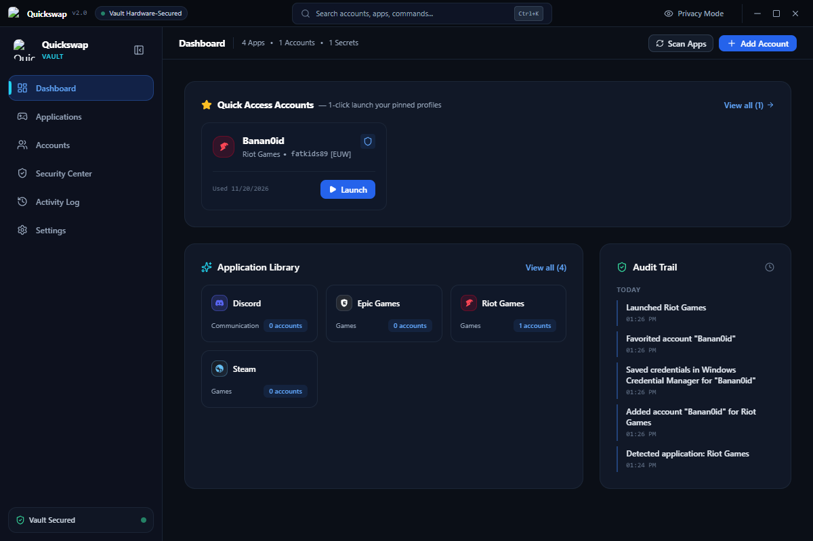
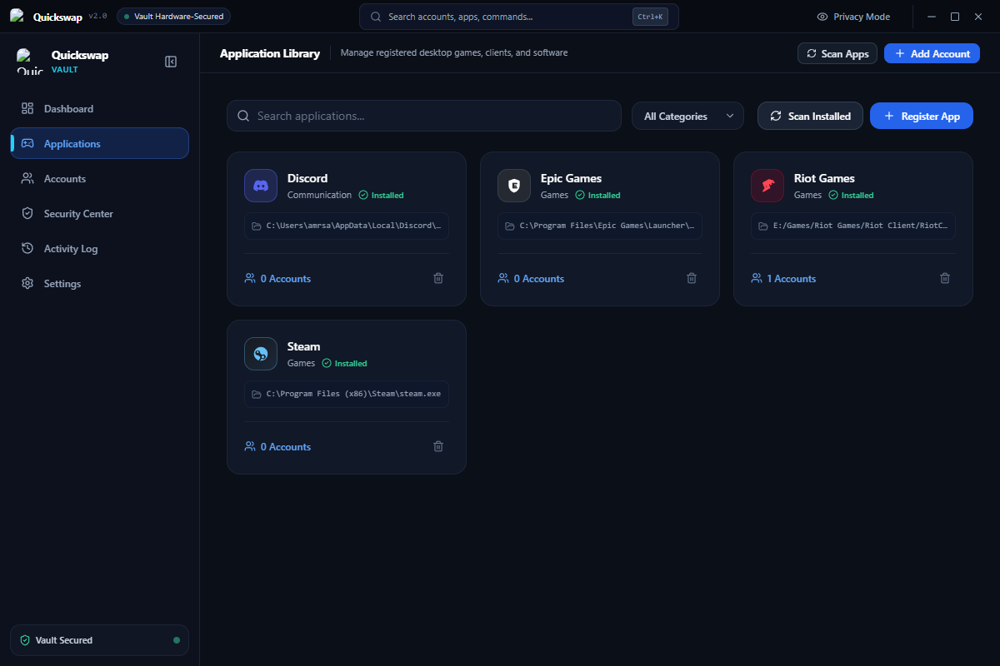

<div align="center">


# Quickswap

### Universal Desktop Account Vault & 1-Click Game Launcher for Windows

[](https://www.electronjs.org/)
[](https://react.dev/)
[](https://www.typescriptlang.org/)
[](https://tailwindcss.com/)
[](https://microsoft.com/windows)
[](https://learn.microsoft.com/en-us/windows/win32/secauthn/credentials-management)
[](https://vitest.dev/)

**Quickswap** is a high-performance, local-first Windows desktop account manager and launcher. It allows gamers, developers, and power users to securely store and switch between multiple gaming and software accounts in a single click—without ever storing plaintext passwords on disk.

</div>

---

## 📸 Screenshots

### 1. Unified Dashboard
> Instant 1-click launch for favorite accounts, detected game libraries, vault health metrics, and tamper-evident audit logs.



---

### 2. Applications Library
> Auto-detects installed platforms (Riot Games, Steam, Epic Games, Discord, Battle.net) or custom Windows software executables.



---

### 3. Accounts Management & Quick Filtering
> Organize profiles with tags, game regions, default accounts, and instant session launch controls.


---

### 4. Security Center & Hardware Vault Verification
> Real-time DPAPI & Windows Credential Manager integrity verification, master password control, and security event logging.


---

### 5. Streamlined Distraction-Free Mode
> Collapsible spring-animated sidebar maximizes screen space for compact desktop setups.


---

## ✨ Key Features

- ⚡ **1-Click Profile Hot-Swapping:** Seamlessly switch accounts for Riot Games (League of Legends, Valorant), Steam, Epic Games, Discord, and custom desktop executables.
- 🛡️ **Zero Plaintext Credentials:** Passwords and tokens are stored natively in the **Windows Credential Manager** (`advapi32.dll`) and encrypted via **Windows DPAPI** (`CurrentUser` scope). SQLite only contains opaque reference pointers.
- 🔒 **Riot Games Session Engine:** Backs up and restores active `RiotGamesPrivateSettings.yaml` sessions with automated login token injection.
- 🎥 **Streamer Privacy Mode (`Ctrl+Shift+P`):** Masks sensitive usernames, emails, tags, and account identifiers with real-time CSS Gaussian blur and peek-on-hover.
- ⌨️ **Command Palette (`Ctrl+K`):** Spotlight-style fuzzy search to launch accounts, register applications, or toggle settings instantly from anywhere in the app.
- ⏱️ **Auto-Wipe Secure Clipboard:** Automatically cleans passwords from the Windows clipboard after 30 seconds—verifying clipboard content before clearing to avoid erasing newly copied user text.
- 🔍 **Native Pipe Security:** C# native helper (`QuickswapSecHelper.exe`) receives payloads through standard input (`stdin`), preventing credentials from leaking to task managers or process inspection tools (`tasklist`, Process Explorer).
- 🎨 **Modern Cyber-Slate UI:** Custom frameless title bar with Windows minimize/maximize/close controls, smooth spring animations, and native dark theme (`#0B0F17`).

---

## 🏗️ Architecture & Security Model

Quickswap is structured as a pnpm monorepo enforcing strict boundary isolation:

```text
quickswap/
├── apps/
│   └── desktop/               # Electron 37 Shell + Vite + React 19 + Tailwind CSS
├── packages/
│   ├── shared/                # Zod schemas, TypeScript types, IPC contracts, errors
│   ├── database/              # SQLite database layer (node:sqlite) + schema migrations
│   ├── security/              # Windows Credential Manager + DPAPI native C# bridge
│   └── core/                  # Application detection, launcher services, Riot session engine
├── docs/
│   └── screenshots/           # Application screenshots for documentation
└── tests/                     # Automated Vitest integration test suites
```

### Security & Threat Mitigation Matrix

| Threat Scenario | Impact | Quickswap Mitigation |
| :--- | :--- | :--- |
| **Physical Disk Theft** | Attacker accesses hard drive offline | **Mitigated:** DPAPI and Windows Credential Vault are cryptographically tied to the user's Windows master key. Database contains zero plaintext secrets. |
| **Network Snooping** | Man-in-the-middle / Wi-Fi interception | **Mitigated:** 100% offline local-first software. Zero cloud telemetry, tracking, or remote API dependencies. |
| **Clipboard Snooping** | Malicious background process monitors clipboard | **Mitigated:** Copied passwords auto-wipe from the clipboard after 30 seconds. |
| **Process Argument Inspection** | Malicious app inspects CLI arguments | **Mitigated:** Sensitive payload data is piped via `stdin` to the compiled C# security helper. |
| **UI Compromise / XSS** | Renderer script injection attempt | **Mitigated:** Hardened Electron preload bridge (`window.quickswapAPI`), strict CSP, `nodeIntegration: false`, `contextIsolation: true`. |

---

## 🚀 Getting Started

### Prerequisites

- **Windows 10 / 11 (64-bit)**
- **Node.js**: `v20.x` or later (LTS recommended)
- **pnpm**: `v9.x` or later (`corepack enable pnpm`)
- **.NET Framework**: 4.0+ (pre-installed on all modern Windows installations for C# DPAPI helper)

### Installation

```bash
# 1. Clone repository
git clone https://github.com/your-username/quickswap.git
cd quickswap

# 2. Install monorepo dependencies
pnpm install

# 3. Build workspace packages & native C# helper
pnpm build
```

---

## 💻 Development & Testing

```bash
# Start desktop application with Vite Hot Module Replacement (HMR)
pnpm dev

# Run full automated Vitest test suite (27 tests)
pnpm test

# Run TypeScript typechecks across all monorepo packages
pnpm typecheck
```

---

## 📦 Production Packaging

To compile standalone desktop binaries (`.exe` installer or portable executable):

```bash
# Build desktop production bundle and installer
pnpm --filter @quickswap/desktop build
pnpm --filter @quickswap/desktop package
```

The resulting distribution binaries will be located in:
`apps/desktop/dist-electron/`

---

## ⌨️ Keyboard Shortcuts

| Shortcut | Action |
| :--- | :--- |
| `Ctrl + K` | Open Universal Command Palette |
| `Ctrl + Shift + P` | Toggle Streamer Privacy Mode |
| `Escape` | Close active modal or command palette |

---

## 📄 License

This project is licensed under the MIT License. Built with privacy and local-first security.
