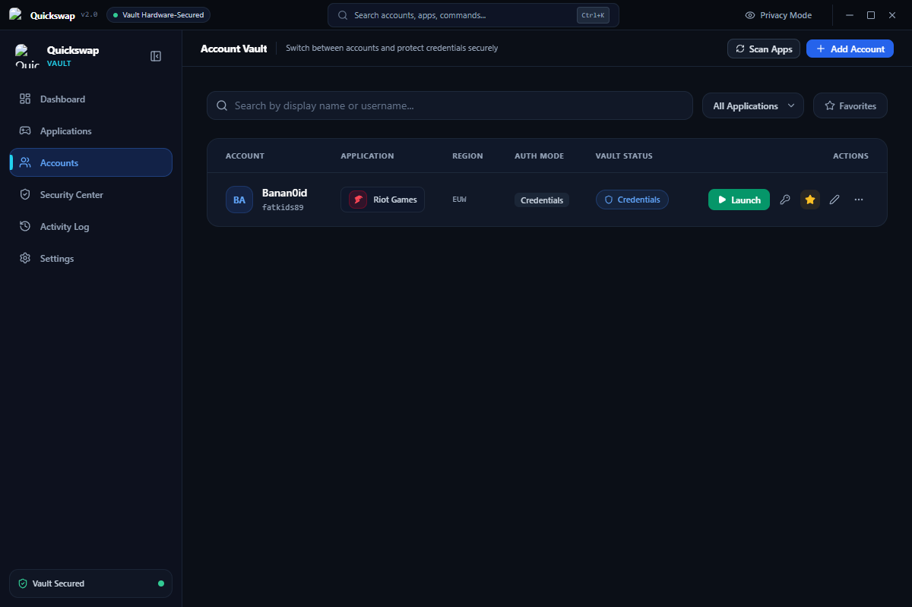
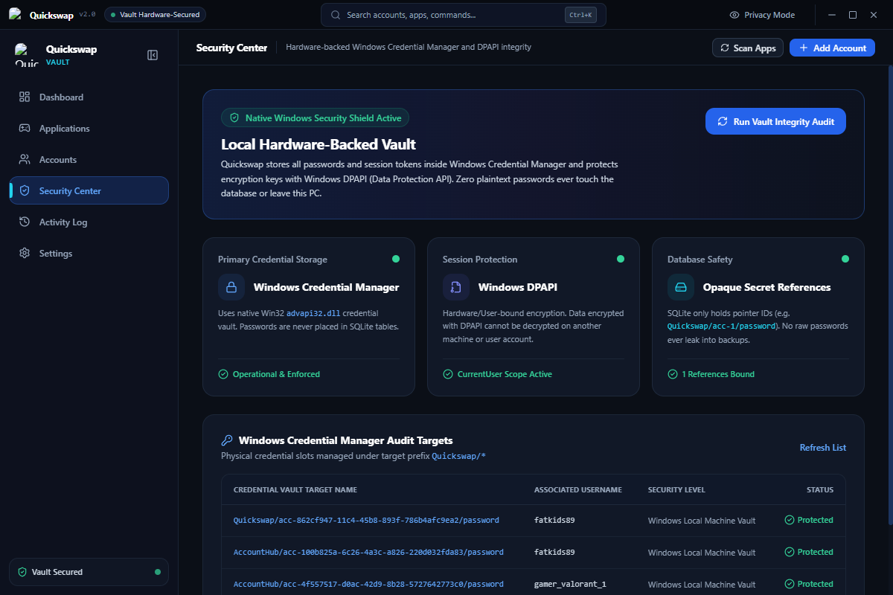
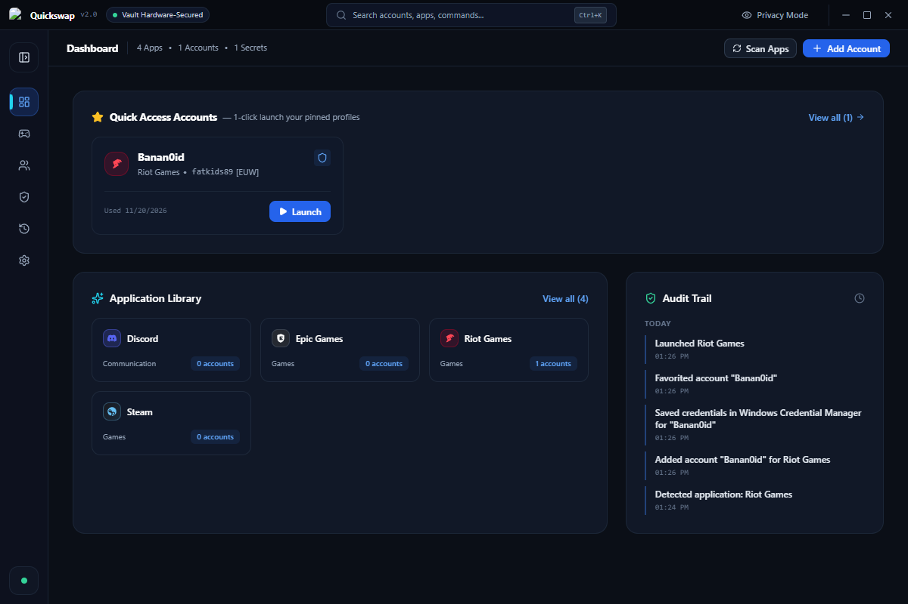

<div align="center">


# Quickswap

### Universal Desktop Account Vault & 1-Click Game Launcher for Windows

[](https://www.electronjs.org/)
[](https://react.dev/)
[](https://www.typescriptlang.org/)
[](https://tailwindcss.com/)
[](https://microsoft.com/windows)
[](https://learn.microsoft.com/en-us/windows/win32/secauthn/credentials-management)
[](https://vitest.dev/)

**Quickswap** is a high-performance, local-first Windows desktop account manager and launcher. It allows gamers, developers, and power users to securely store and switch between multiple gaming and software accounts in a single click—with cryptographic envelope encryption, zero plaintext secrets on disk, and 100% offline local privacy.

</div>

---

## 📸 Screenshots

### 1. Unified Dashboard
> Instant 1-click launch for favorite accounts, detected game libraries, vault health metrics, and tamper-evident audit logs.


---

### 2. Applications Library
> Auto-detects installed platforms (Riot Games, Steam, Epic Games, Discord, Battle.net) or custom Windows software executables.


---

### 3. Accounts Management & Quick Filtering
> Organize profiles with tags, game regions, default accounts, and instant session launch controls.



---

### 4. Security Center & Hardware Vault Verification
> Real-time DPAPI & Windows Credential Manager integrity verification, master password control, tamper-evident audit chain verification, and security event logging.



---

### 5. Streamlined Distraction-Free Mode
> Collapsible spring-animated sidebar maximizes screen space for compact desktop setups.



---

## ✨ Key Features

- ⚡ **1-Click Profile Hot-Swapping:** Seamlessly switch accounts for Riot Games (League of Legends, Valorant), Steam, Epic Games, Discord, and custom desktop executables.
- 🛡️ **Cryptographic Envelope Encryption:** Secrets, session backups, and sensitive metadata (usernames, tags, launch arguments) are protected by a random 256-bit Data Encryption Key (DEK) wrapped with an AES-256-GCM Key Encryption Key (KEK) derived via PBKDF2-SHA256 (600,000 iterations).
- 🔐 **Dual-Layer Windows Vault:** Credentials are fundamentally isolated inside the native **Windows Credential Manager** (`advapi32.dll`) and encrypted via **Windows DPAPI** (`CurrentUser` scope). SQLite stores only opaque references and encrypted envelopes.
- 🔒 **Riot Games Session Engine:** Backs up and restores active `RiotGamesPrivateSettings.yaml` sessions with encrypted storage at rest (`.bak.enc`), automated login token injection, and automatic crash recovery on next application startup.
- ⏱️ **Configurable Auto-Lock:** Automatically locks the vault on idle timeout, Windows session lock (`Win+L`), sleep/suspend, or minimize-to-tray. Memory-zeroing (`fill(0)`) scrubs keys upon locking.
- 📜 **Tamper-Evident Audit Hash Chain:** Activity and security logs are cryptographically linked using a continuous SHA-256 hash chain with a one-click "Verify Audit Log" action.
- 💾 **Encrypted Backup & Migration:** Export passphrase-protected encrypted archives (`QUICKSWAP_ENCRYPTED_BACKUP_V1`) with SHA-256 ciphertext integrity verification, inspectable preview, and conflict resolution (`overwrite`, `skip`, `keep_both`). Zero-loss legacy migration detects and upgrades older AccountHub vaults.
- 🎥 **Streamer Privacy Mode (`Ctrl+Shift+P`):** Real-time Gaussian blur covers account usernames, emails, tags, tooltips, audit logs, and tray alerts with peek-on-hover.
- ⌨️ **Command Palette (`Ctrl+K`):** Spotlight-style fuzzy search to launch accounts, register applications, or toggle settings instantly from anywhere in the app.
- 📋 **Secure Clipboard with Sync Blocking:** Excludes copied credentials from Windows Clipboard History (`CanIncludeInClipboardHistory: 0`) and cloud clipboard synchronization (`CanUploadToCloudClipboard: 0`), auto-clearing secrets after 30 seconds only if unchanged.
- 🔍 **Native Pipe Security & Tamper Check:** C# native helper (`QuickswapSecHelper.exe`) is integrity-verified via SHA-256 before launch, runs as an isolated stdio daemon, and never receives secrets via command-line arguments.
- 🎨 **Modern Cyber-Slate UI:** Custom frameless title bar with Windows minimize/maximize/close controls, smooth spring animations, and native dark theme (`#0B0F17`).

---

## 🏗️ Architecture & Security Model

Quickswap is structured as a pnpm monorepo enforcing strict boundary isolation:

```text
quickswap/
├── apps/
│   └── desktop/               # Hardened Electron 45 Shell + Vite + React 19 + Tailwind CSS
├── packages/
│   ├── shared/                # Zod schemas, TypeScript types, IPC contracts, errors
│   ├── database/              # SQLite database layer (node:sqlite) + schema migrations
│   ├── security/              # PBKDF2/AES-GCM envelope, WinCred + DPAPI native C# bridge
│   └── core/                  # Application detection, launcher services, Riot session engine
├── docs/
│   └── screenshots/           # Application screenshots for documentation
├── scripts/                   # Release packaging and SHA-256 checksum generation
└── tests/                     # Automated Vitest integration test suites
```

### Key Hierarchy & Storage Architecture

```
[Master Password]
       │
       ▼ (PBKDF2-SHA256, 600,000 iterations, 32-byte salt)
[Key-Encryption Key (KEK)]
       │
       ▼ (AES-256-GCM unwrap)
[Data-Encryption Key (DEK)] ───► In-Memory Only (Zeroed on lock / suspend / idle)
       │
       ├─► Encrypts/Decrypts Account Metadata (usernames, tags, launch arguments)
       ├─► Encrypts/Decrypts Riot Session Backups (.bak.enc) at rest
       └─► Second defense layer behind Windows Credential Manager & DPAPI
```

---

## 🛡️ Threat Model

### What Quickswap Defends Against

| Threat Scenario | Attack Vector | Quickswap Defense Mechanism |
| :--- | :--- | :--- |
| **Physical Disk Theft / Offline Extraction** | Attacker accesses hard drive or database file offline | **Mitigated:** Database contains zero plaintext secrets. Sensitive metadata and sessions are encrypted with AES-256-GCM using a 600,000-iteration KEK. Passwords remain in Windows Credential Manager protected by DPAPI. |
| **Memory / Process Argument Inspection** | Malicious processes inspect command line (`tasklist`, `Get-Process`) | **Mitigated:** Secrets and session payloads are communicated exclusively through standard input (`stdin`) to the native security helper. Command-line arguments never contain secrets. |
| **Clipboard Snooping & Cloud Sync** | Background sniffers or Microsoft Cloud Clipboard synchronize copied secrets | **Mitigated:** Clipboard writes explicitly set `CanIncludeInClipboardHistory = 0` and `CanUploadToCloudClipboard = 0`. Secrets are wiped after 30 seconds only if still present. |
| **Tampering with Stored Logs** | Attacker modifies SQLite logs to hide unauthorized access | **Mitigated:** Audit log entries form an unbroken cryptographic SHA-256 hash chain ($H_n = \text{SHA256}(H_{n-1} + \text{entry})$). Verification detects any insertion, deletion, or modification. |
| **Native Helper Substitution** | Attacker replaces `QuickswapSecHelper.exe` with a malicious binary | **Mitigated:** Helper binary integrity is verified against a pinned SHA-256 sidecar checksum before every launch. Execution is aborted if the binary has been modified. |
| **Renderer / UI Exploitation (XSS)** | Malicious content injected into renderer process | **Mitigated:** Strict Electron hardening: `sandbox: true`, `contextIsolation: true`, `nodeIntegration: false`, strict CSP, blocked external navigation/`window.open`, and Electron Fuses (`RunAsNode` disabled, ASAR integrity enabled). IPC arguments validated with Zod. |
| **Network Snooping / MITM** | Remote surveillance or telemetry interception | **Mitigated:** 100% offline architecture. No analytics, tracking, or remote cloud servers. |

### What Quickswap Does NOT Defend Against

- **Compromised Operating System (Kernel Rootkits / Ring-0 Malware):** If the Windows operating system is infected with kernel rootkits, drivers, or system-level keyloggers running under the same user session or with `SeDebugPrivilege`, memory can be read while the vault is actively unlocked.
- **Physical Hardware Keyloggers:** Hardware-level USB keyloggers capturing master password keystrokes before reaching Windows cannot be mitigated by software.
- **Volatile RAM Inspection while Vault is Active:** While the vault is unlocked, the DEK resides in volatile memory. Quickswap mitigates window exposure by actively zeroing memory (`fill(0)`) immediately on lock, sleep, or idle.

---

## ⚖️ Anti-Cheat & Terms of Service Disclaimer

> [!NOTE]
> **Quickswap does NOT modify game binaries, inject code into running processes, or bypass anti-cheat systems.**

- **How Session Hot-Swapping Operates:** Quickswap manages account switching by reading, encrypting, and writing standard configuration files (such as `RiotGamesPrivateSettings.yaml`) **while the game and client are completely closed**. It does not hook APIs, inject DLLs, alter game files, or interfere with game execution.
- **Anti-Cheat Compatibility:** Quickswap is designed to be fully compatible with anti-cheat software (including **Riot Vanguard**, **Easy Anti-Cheat**, and **BattlEye**). It never attaches to or interacts with active protected game processes.
- **Publisher Terms of Service:** Users remain responsible for complying with the respective Terms of Service and End User License Agreements (EULA) of game publishers. Quickswap provides local account management convenience and does not encourage multi-accounting where prohibited.

---

## 🔐 Verified Downloads & Release Integrity

Official Quickswap releases provide cryptographic SHA-256 checksums and digital Authenticode signatures. Always verify the downloaded installer before running.

### 1. Verifying SHA-256 Checksum (PowerShell)

Run the following command in PowerShell on your downloaded installer:

```powershell
Get-FileHash -Algorithm SHA256 "Quickswap-Setup-1.0.0.exe"
```

Compare the output hash against the official `checksums.sha256` manifest published with the release:

```powershell
# Automatically check against downloaded checksums file
$hash = (Get-FileHash -Algorithm SHA256 "Quickswap-Setup-1.0.0.exe").Hash.ToLower()
Get-Content checksums.sha256 | Select-String $hash
```

### 2. Verifying Authenticode Signature

To inspect the digital signature of the installer:

```powershell
Get-AuthenticodeSignature "Quickswap-Setup-1.0.0.exe"
```

A valid release will report `Status: Valid`.

---

## 🚀 Getting Started

### Prerequisites

- **Windows 10 / 11 (64-bit)**
- **Node.js**: `v20.x` or later (LTS recommended)
- **pnpm**: `v9.x` or later (`corepack enable pnpm`)
- **.NET Framework**: 4.0+ (pre-installed on modern Windows for C# security helper)

### Installation

```bash
# 1. Clone repository
git clone https://github.com/Amrsamy19/quickswap.git
cd quickswap

# 2. Install monorepo dependencies
pnpm install

# 3. Build workspace packages & native C# helper
pnpm build
```

---

## 💻 Development & Testing

```bash
# Start desktop application with Vite Hot Module Replacement (HMR)
pnpm dev

# Run automated Vitest test suites (Phase 1 Security & Phase 2 Data Safety)
pnpm test

# Run TypeScript typechecks across all monorepo packages
pnpm typecheck

# Run linter
pnpm lint
```

---

## 📦 Production Packaging

To compile standalone desktop binaries (`.exe` NSIS installer and portable executable) and compute release checksums:

```bash
# Build desktop production release and generate SHA-256 manifest
pnpm package:release
```

Release binaries and `checksums.sha256` will be generated in:
`apps/desktop/dist-release/`

### Clean Uninstallation

When uninstalling via the Windows Control Panel, the NSIS uninstaller explicitly prompts:
> *"Do you want to permanently delete all saved Quickswap vault credentials and local application data?"*
Selecting **Yes** wipes `%APPDATA%\Quickswap` and local registry entries.

---

## ⌨️ Keyboard Shortcuts

| Shortcut | Action |
| :--- | :--- |
| `Ctrl + K` | Open Universal Command Palette |
| `Ctrl + Shift + P` | Toggle Streamer Privacy Mode |
| `Escape` | Close active modal or command palette |

---

## 📄 License

This project is licensed under the MIT License. Built with privacy, transparency, and local-first security.
